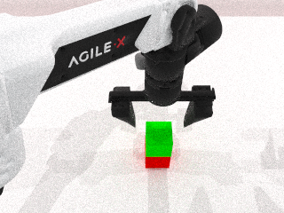

# VLA 学习记录

以 RoboTwin / LingBot-VLA 为线索，学习机器人仿真、控制、示范数据、模仿学习与闭环评测。

## 当前进度

2026-10-20：已跑通 Aloha-AgileX 双积木堆叠专家任务。seed 0 的规划与回放均通过成功判定，保存 325 帧、4 路相机图像、14 维关节目标、末端位姿、视频和 HDF5。尚未训练策略模型。

- [今日结果、环境与兼容性修改](2026-10-20/今日进度.md)
- [学习与复现说明](2026-10-20/学习与复现.md)
- [四相机任务视频](2026-10-20/expert/inspection/four_cameras.mp4)
- [原始头部相机视频](2026-10-20/expert/video/episode0.mp4)
- [成功结果与种子](2026-10-20/expert/result.json)
- [实际数据字段](2026-10-20/expert/inspection/schema.json)
- [昨日总结与论文阅读路线](2026-10-19/今日总结与明日计划.md)
- [最小 SAPIEN 验证脚本](scripts/sapien_smoke.py)



当前使用工作区内的独立 Python/CUDA 编译环境；RoboTwin 有一处杂物资产按需加载补丁，渲染关闭了不兼容的 OIDN 去噪。详情与复现步骤见今日文档。单条示范的 HDF5 在本地 `2026-10-20/expert/data/episode0.hdf5`，`data/` 不纳入版本管理。

## 下一步

先复现并读懂这条专家示范，再收集小批数据，构建教学用模仿学习训练、保存与加载和闭环评测。

## 复现当前基础测试

本机工作目录 `/home/zqw/VLA-learning`，已创建 `.venv-sim` 后运行：

```bash
.venv-sim/bin/python scripts/sapien_smoke.py --render
```

其他机器需先安装 NVIDIA 驱动、Python 3.10、ffmpeg，并使用依赖快照准备独立环境。该命令是已有环境中的验证命令，不是完整安装步骤。当前脚本输出固定至 `2026-10-19/sapien_smoke/`。

本仓库保存学习文档、脚本和小型验证产物。RoboTwin 第三方源码、Python 环境、下载缓存、模型权重和完整数据集不纳入版本管理。
