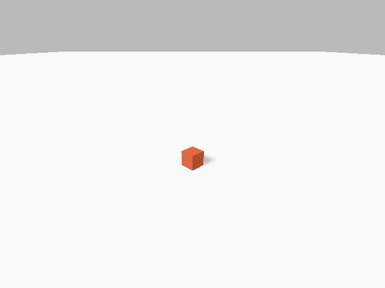

# VLA 学习记录

以 RoboTwin / LingBot-VLA 为线索，学习机器人仿真、控制、示范数据、模仿学习与闭环评测。

## 当前进度

2026-10-19：完成独立 Python/SAPIEN 环境、GPU 驱动恢复、物理仿真和相机渲染验证。尚未运行机械臂专家任务或训练模型。

- [今日总结、明日计划与论文阅读路线](2026-10-19/今日总结与明日计划.md)
- [详细部署记录（含历史排障过程）](2026-10-19/部署进度.md)
- [最小验证脚本](scripts/sapien_smoke.py)
- [依赖快照](2026-10-19/sapien-requirements.lock.txt)
- [渲染结果](2026-10-19/sapien_smoke/render_result.json)
- [方块落地视频](2026-10-19/sapien_smoke/falling_box.mp4)



## 下一步

核验 RoboTwin 依赖和 RTX 5060 兼容性，准备单个任务资产，生成并检查一条机械臂专家示范。

## 复现当前基础测试

本机工作目录 `/home/zqw/VLA学习`，已创建 `.venv-sim` 后运行：

```bash
.venv-sim/bin/python scripts/sapien_smoke.py --render
```

其他机器需先安装 NVIDIA 驱动、Python 3.10、ffmpeg，并使用依赖快照准备独立环境。该命令是已有环境中的验证命令，不是完整安装步骤。当前脚本输出固定至 `2026-10-19/sapien_smoke/`。

本仓库保存学习文档、脚本和小型验证产物。RoboTwin 第三方源码、Python 环境、下载缓存、模型权重和完整数据集不纳入版本管理。
